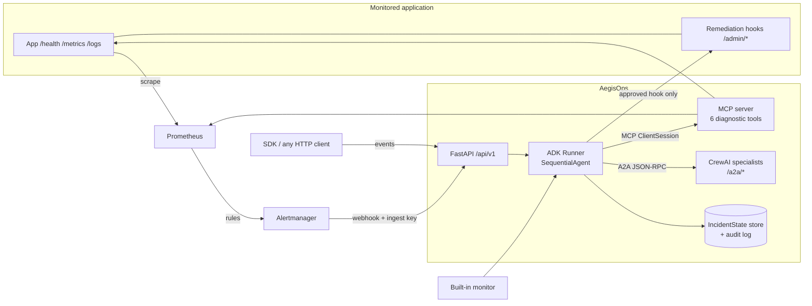
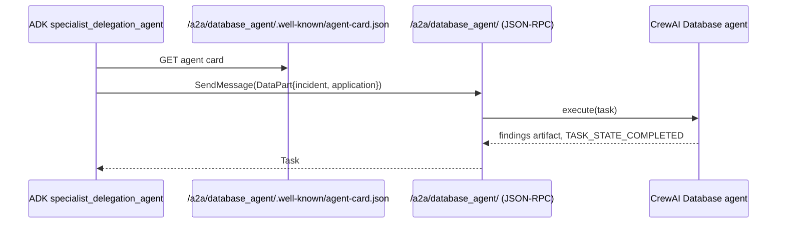
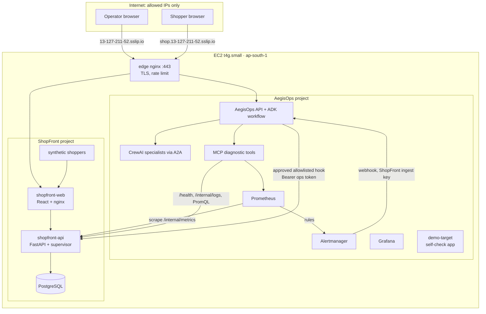

# AegisOps Architecture

## Components

## Incident lifecycle (Google ADK)

Two ADK `SequentialAgent`s (`app/sre/pipeline.py`) run under an ADK `Runner` with an `InMemorySessionService`. Each step is a custom `BaseAgent`. `before_agent_callback` / `after_agent_callback` time every agent (Prometheus `aegis_agent_duration_seconds`, OTel span `agent.<name>`, incident timeline).

| # | ADK agent | Does |
|---|---|---|
| 1 | incident_detection_agent | severity → priority, records the alert as evidence, opens the incident |
| 2 | context_discovery_agent | loads the registered app (services, dependencies, stack, deployment, hooks), checks health via MCP |
| 3 | triage_agent | picks specialists from the alert text and the registered architecture |
| 4 | evidence_collection_agent | MCP: metrics, logs (10-min window), live endpoint probes, container, DB |
| 5 | specialist_delegation_agent | A2A tasks to the CrewAI specialists, in parallel |
| 6 | evidence_synthesis_agent | causal correlation → root cause, confidence, alternatives, missing evidence, similar past incidents |
| 7 | remediation_planning_agent | ranks the app's hooks for the root cause; phase → `awaiting_approval` or `closed_no_action` |
| – | *human approval* | `POST /api/v1/incidents/{id}/remediation/{option}/approve` (admin or sre role) |
| 8 | remediation_execution_agent | POSTs the approved hook only |
| 9 | recovery_verification_agent | re-checks health and metrics, compares before/after |
| 10 | postmortem_agent | structured postmortem (+ the CrewAI 3-agent postmortem crew when an LLM is configured) |

**Shared state.** One Pydantic `IncidentState` (`app/sre/models.py`) carries metadata, application context, alert, evidence (with ids), triage, specialist findings, the A2A log, RCA, options, approvals, executions, verification, postmortem, timeline and per-agent timings. It is written atomically after every step (`app/sre/store.py`). Completed steps are skipped on re-run, so `resume_pending()` at startup finishes investigations interrupted by a restart. Evidence collection skips sources it has already collected.

**Dedupe.** While an incident for an app is open, further alerts for that app are correlated into it (`initial_alert.related_alerts`) instead of opening new incidents.

## Reasoning

* **With an LLM key**, each specialist is a CrewAI `Agent` + `Task` (`output_pydantic`) reasoning over the evidence. Evidence is wrapped as untrusted data. Returned evidence ids are checked, and findings without valid evidence are capped at weight 0.2.
* **Without a key**, the deterministic analyzer for that specialty runs (`app/sre/analysis.py`). The mode is recorded on every finding.
* **Synthesis** is shared by both paths. Causes explain symptoms (e.g. a DB failure explains 5xx errors, latency and unavailability). A symptom explained by a well-supported cause is down-weighted. Hypotheses are ranked by a confidence that grows with the score *and* with the number of independent evidence types. Below 0.45 the RCA is marked `insufficient_evidence`, no hook is proposed, and the missing evidence is listed.
* **History.** Past incidents with the same root cause are listed, and hooks that verifiably fixed that cause before are ranked first.

## MCP

`app/sre/mcp_server.py` is a FastMCP server. Agents use it through an MCP `ClientSession` (in-memory transport). External MCP clients can run it over stdio: `python -m app.sre.mcp_server`.

| Tool | Reaches | Notes |
|---|---|---|
| `check_http_health` | any URL on a registered app host | SSRF guard: unregistered hosts are refused |
| `query_metrics` | Prometheus `/api/v1/query` or the app's `/metrics` | maps app metrics to standard signals via `metric_queries` |
| `prometheus_query` | the app's Prometheus | PromQL character allowlist |
| `search_logs` | app log endpoint + ingested events | filters by level, service, window and text; redacts secrets, neutralises injection |
| `inspect_container` | `docker inspect` / `docker stats` | fixed argv, validated container name, no shell |
| `check_database` | TCP connect to the registered DB host:port | read-only reachability |

Every tool has typed arguments and a timeout, and returns a `ToolResult` that the client re-validates with Pydantic before agents use it. Calls are counted in `incident_mcp_tool_calls_total{mode="mcp"}`.

## A2A

`app/sre/a2a_specialists.py` serves five A2A agents with `a2a-sdk` 1.3 (protocol 1.0):

* Agent card: `GET /a2a/<agent>/.well-known/agent-card.json`
* JSON-RPC endpoint: `POST /a2a/<agent>/` (`SendMessage`, `GetTask`, …)

The ADK orchestrator is the A2A client. It resolves the card, sends a user-role message with a JSON DataPart (`{incident, application}`), and reads findings from the completed task's artifact. Task state, duration and mode are logged in `IncidentState.a2a_log` and `incident_a2a_messages_total`. `AEGIS_A2A_MODE=inprocess` routes those HTTP requests to the same process through ASGI; `network` uses `AEGIS_PUBLIC_URL`, so specialists can run as separate services.

## Security

| Control | Where |
|---|---|
| Admin API auth | JWT bearer; register/approve/reject need the `admin` or `sre` role |
| Ingestion auth | per-app ingest key (SHA-256 hash stored, constant-time compare), via `X-AegisOps-Key` or Bearer |
| No arbitrary execution | only hooks the app registered, on the app's own host (checked at registration), after human approval; LLM output never becomes a command |
| Hook auth | `AEGIS_HOOK_TOKEN_<APP>` from the environment, never stored in state |
| SSRF | MCP HTTP tools only reach registered app hosts |
| Prompt injection | untrusted text is redacted, injection phrases are replaced with `[FILTERED-INSTRUCTION]` and flagged, and text is wrapped in `<untrusted_data>` for LLMs |
| Secret hygiene | keys, passwords, bearer tokens and DSNs are redacted in logs and evidence; the ingest key is shown once |
| Validation | Pydantic on every request, tool result, A2A payload and LLM output |
| Rate limiting | webhook 120/min/IP, admin 60/min/IP |
| Audit | `audit.log.jsonl`: registrations, incidents, approvals, executions (`GET /api/v1/audit`) |
| Container | non-root user, health checks |

## Observability

* Prometheus (`/api/metrics`): `aegis_incidents_total`, `aegis_agent_duration_seconds`, `aegis_investigation_duration_seconds`, `aegis_recovery_total`, `aegis_approvals_total`, `aegis_application_up`, plus MCP and A2A counters.
* The Grafana dashboard "AegisOps - Incident Operations" is provisioned automatically.
* OpenTelemetry spans per agent, exported over OTLP/HTTP when `OTEL_EXPORTER_OTLP_ENDPOINT` is set (Jaeger, Tempo, or Langfuse's OTLP endpoint). Without it, the incident timeline, audit log and metrics are the local record.

## API (`/api/v1`)

| Method | Path | Auth |
|---|---|---|
| POST | `/applications/register` | admin/sre |
| GET | `/applications`, `/applications/{name}`, `/applications/{name}/health` | any user |
| POST | `/incidents/webhook` | app ingest key |
| POST | `/incidents` (manual) | admin/sre |
| GET | `/incidents`, `/incidents/{id}`, `/incidents/{id}/rca`, `/incidents/{id}/remediation`, `/incidents/{id}/postmortem` | any user |
| POST | `/incidents/{id}/investigate` | admin/sre |
| POST | `/incidents/{id}/remediation/{option_id}/approve` · `/reject` | admin/sre |
| GET | `/agents`, `/mcp/tools`, `/system/health` | any user / public |
| GET | `/console` | public page; data calls need sign-in |
| GET | `/audit` | admin/sre |

Full schemas: http://localhost:8000/docs.

## Known limits

* File-backed state is single-writer: run one AegisOps replica, and move to PostgreSQL before scaling out.
* LLM specialists sometimes report findings outside their focus, which raises the finding count for the dominant cause.
* The demo app's `traffic` fault scales its reported request rate rather than generating real flood load.

## Two applications: AegisOps and ShopFront

AegisOps and the application it watches are separate Compose projects on one EC2 host. They share only the `aegis-net` Docker network; ShopFront's database stays on ShopFront's private network.

**Incident flow for a ShopFront failure:** fault → ShopFront metrics change → Prometheus rule fires (`for` 15–30 s) → Alertmanager posts to `/api/v1/incidents/webhook` with ShopFront's key → incident opened (alerts for an already-open ShopFront incident are correlated into it) → ADK workflow: context discovery, triage, MCP evidence (health, PromQL signals including `up` and `db_up`, logs from the last `log_window_minutes`, live endpoint probes), A2A delegation to the five CrewAI specialists, synthesis, remediation plan → human approval in the console → only the approved hook is called → after `verify_settle_seconds` AegisOps re-checks health and metrics → postmortem.

**Isolation guarantees:** ShopFront failures never touch AegisOps containers (verified: AegisOps health stays 200 during every ShopFront fault). Hooks can only target ShopFront's own host, so a ShopFront remediation can never modify AegisOps or AWS infrastructure.
