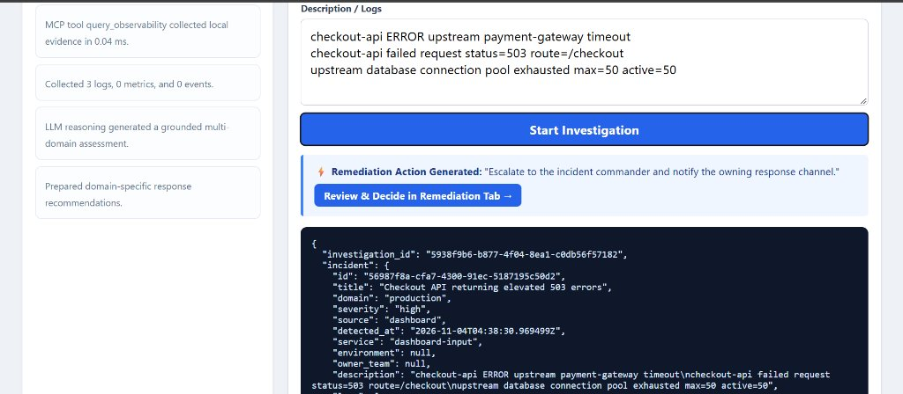
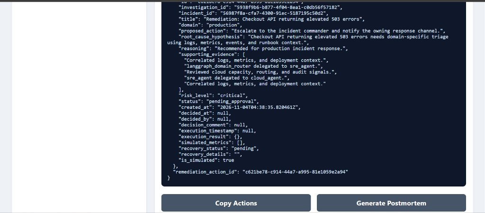
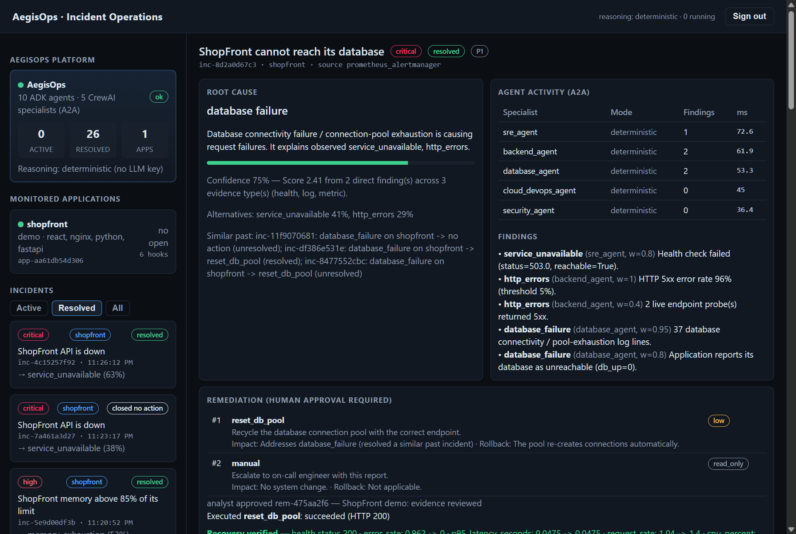
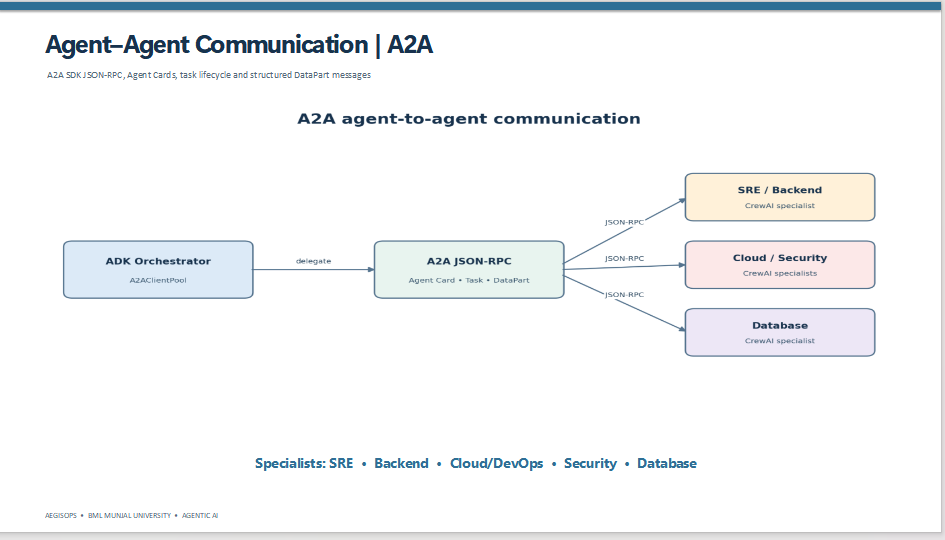
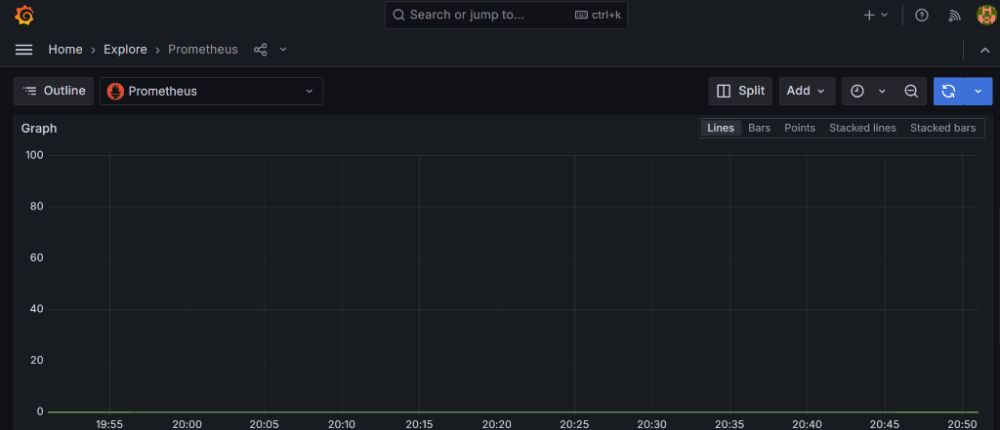
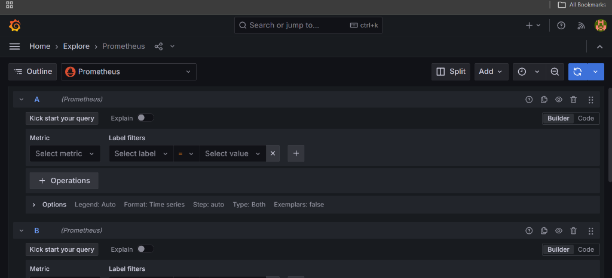
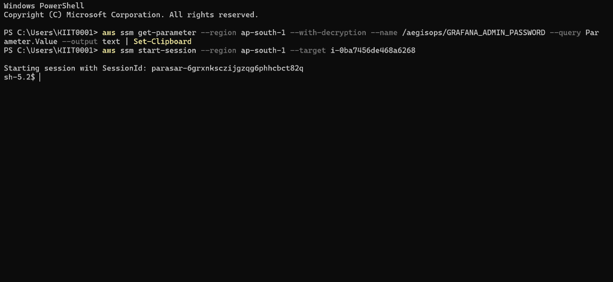
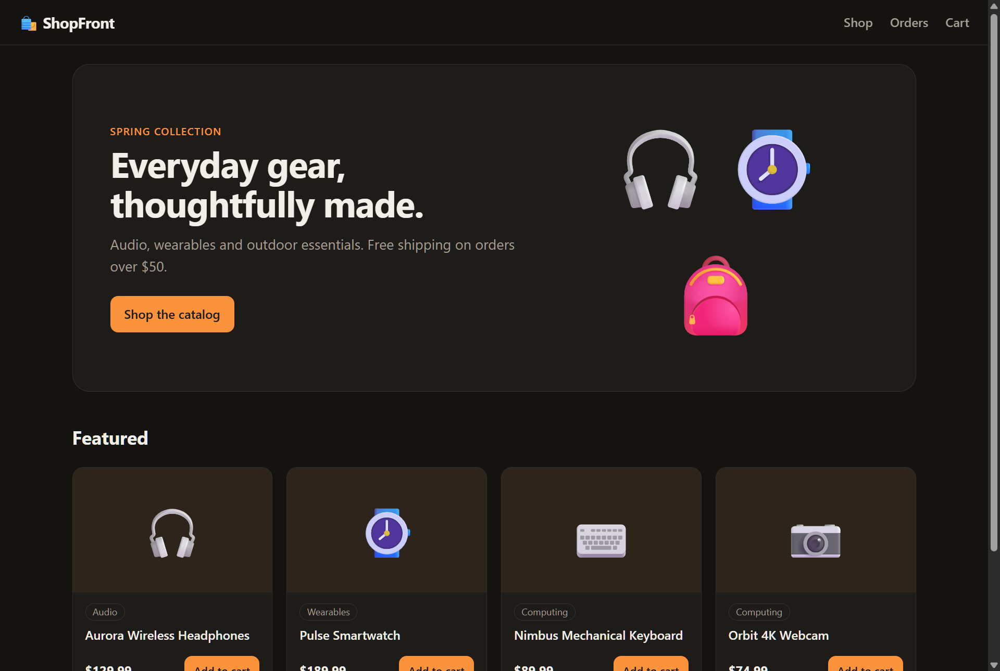
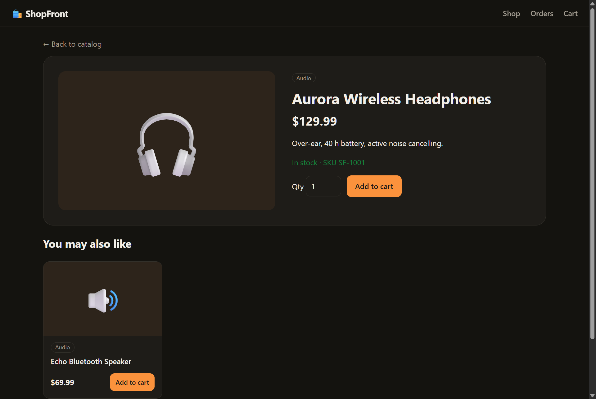

# AegisOps — Agentic AI Incident Investigation & Controlled Self-Healing

AegisOps watches applications you register, detects incidents, investigates them with a team of AI agents, proposes a fix, waits for a human to approve it, executes only that pre-registered fix, verifies recovery, and writes the postmortem.

```
Application ─► Monitoring (Prometheus/Alertmanager or built-in poller) ─► Incident Detection
  ─► Google ADK workflow ─► MCP evidence tools ─► A2A ─► CrewAI specialists
  ─► Root-cause synthesis ─► Remediation plan ─► Human approval ─► Allowlisted hook
  ─► Recovery verification ─► Postmortem ─► Knowledge for the next incident
```

| Piece | Implementation |
|---|---|
| Orchestration | **Google ADK** `SequentialAgent` of 10 custom agents run by an ADK `Runner` (`app/sre/pipeline.py`) |
| Specialist reasoning | **CrewAI** SRE, Backend, Cloud/DevOps, Security, Database agents (`app/sre/a2a_specialists.py`) |
| ADK ↔ CrewAI | **A2A protocol** (`a2a-sdk` JSON-RPC, agent cards, tasks, artifacts) |
| Evidence | **MCP** server with 6 real tools: HTTP health, metrics (Prometheus or scrape), PromQL, logs, Docker, DB probe (`app/sre/mcp_server.py`) |
| State | Typed Pydantic `IncidentState`, persisted after every step; resumes after restart |
| Safety | Human approval, app-registered hooks only, guardrails, RBAC, rate limits, audit log |
| Observability | Prometheus metrics, Grafana dashboard, OpenTelemetry spans, ADK callbacks, incident timeline |

Docs: [SHARING.md](SHARING.md) (run + self-check on any laptop) · [ARCHITECTURE.md](ARCHITECTURE.md) · [APPLICATION_INTEGRATION.md](APPLICATION_INTEGRATION.md) · [DEPLOYMENT.md](DEPLOYMENT.md) · [EVALUATION_REPORT.md](EVALUATION_REPORT.md) · [EVALUATION_RUNBOOK.md](EVALUATION_RUNBOOK.md) (manual live demo) · [shopfront/README.md](shopfront/README.md)

## Live on AWS

| | URL | Access |
|---|---|---|
| AegisOps console | https://13-127-211-52.sslip.io/ | operator login; allowed IPs only |
| ShopFront store (monitored app) | https://shop.13-127-211-52.sslip.io/ | allowed IPs only |

## ShopFront: a real application monitored by AegisOps

[`shopfront/`](shopfront/README.md) is a separate e-commerce store (React + FastAPI + PostgreSQL) running as its own Compose project next to AegisOps. It is registered through the normal registration API, scraped by Prometheus, alerted on by six rules, and connected through Alertmanager to the AegisOps webhook with its own ingest key. A demo-only, token-protected fault module can break it in six realistic ways (HTTP 500, latency, database, CPU, memory, downtime); AegisOps detects each one, investigates, proposes an allowlisted fix, waits for approval, executes it and verifies recovery.

```bash
docker compose run --rm shopfront-check
```

That runs all six scenarios end to end (needs both stacks up; see the ShopFront guide).

## Quick start (local, no Docker)

Requires Python 3.11 and [uv](https://docs.astral.sh/uv/).

```bash
uv sync
```

```bash
cp .env.example .env
```

```bash
uv run python scripts/run_demo.py --scenario db
```

This starts the ShopFront demo app (:9000) and AegisOps (:8000), registers the app, injects a database fault, lets AegisOps detect and investigate it, asks you to approve the fix, verifies recovery and prints the postmortem. Add `--auto-approve` to skip the prompt. Full benchmark:

```bash
uv run python scripts/run_demo.py --scenario all --auto-approve --report evals/reports/sre_benchmark.json
```

Scenarios: `db`, `memory`, `cpu`, `errors`, `slow`, `down`, `bad_deploy`, `traffic`, `none` (healthy control).

Run AegisOps alone:

```bash
uv run uvicorn app.main:app --reload
```

- Console: http://localhost:8000/ (sign in with `DEMO_USERNAME` / `DEMO_PASSWORD`)
- Swagger: http://localhost:8000/docs
- Metrics: http://localhost:8000/api/metrics

## Quick start (Docker Compose)

```bash
docker compose up -d --build
```

```bash
docker compose exec aegisops python scripts/run_demo.py --docker --scenario db --auto-approve
```

In Compose, detection uses the real monitoring path: Prometheus alert rule → Alertmanager → AegisOps webhook.

| Service | URL |
|---|---|
| AegisOps console / API | http://localhost:8000 · http://localhost:8000/docs |
| ShopFront demo app | http://localhost:9000 |
| Prometheus | http://localhost:9090 |
| Alertmanager | http://localhost:9093 |
| Grafana (admin/admin) | http://localhost:3000 → dashboard "AegisOps - Incident Operations" |

## Credentials

Nothing is required to start. Without LLM keys AegisOps uses deterministic evidence scoring and says so (`reasoning_mode` on every finding, `llm_mode` on `/api/v1/system/health`).

| Variable | Needed for |
|---|---|
| `GEMINI_API_KEY` + `GEMINI_MODEL` (or `OPENAI_API_KEY`) | CrewAI LLM reasoning for specialists and postmortem |
| `JWT_SECRET_KEY`, `DEMO_PASSWORD` | Must be changed for any shared deployment |
| `AEGIS_HOOK_TOKEN_<APP>` | Token AegisOps sends to an app's remediation hooks |
| `OTEL_EXPORTER_OTLP_ENDPOINT`, `LANGFUSE_*` | Optional trace export |
| AWS account details | AWS deployment (pending, see DEPLOYMENT.md) |

## Tests

```bash
uv run pytest
```

See [EVALUATION_REPORT.md](EVALUATION_REPORT.md) for test counts and the live benchmark.

## Repository map

```
app/sre/            AegisOps SRE platform (pipeline, MCP, A2A, analysis, store, routes, console)
app/services/       ADK→CrewAI brief pipeline and legacy SOC/RAG services
app/api/routes.py   Legacy /api endpoints (SOC investigation, RAG ingestion, reports, remediations)
demo_app/           ShopFront demo target (independent FastAPI app) + its registration manifest
sdk/                Optional Python SDK (client + ASGI middleware)
scripts/run_demo.py End-to-end demo and benchmark harness
docker/             Prometheus rules, Alertmanager, Grafana provisioning
infra/aws/          AWS deployment (pending account details)
```

The legacy multi-domain SOC/RAG endpoints (`/api/investigate`, `/api/incidents/investigate`, `/api/adk/investigate`, `/api/ingest/*`) are kept and still tested; they now run as plain sequential pipelines (LangGraph was removed).

---

## Demo Screenshots

### AegisOps Console — Investigation & Human Approval


*MCP tool `query_observability` collecting evidence (logs, metrics) in real-time during an active investigation.*


*Human-in-the-loop approval UI: operator must explicitly approve or reject before any remediation executes.*


*Structured JSON remediation plan with root-cause hypothesis, supporting evidence, and risk level.*


*Full incident console showing a detected ShopFront database failure with ADK pipeline timeline.*

---

### A2A Agent Communication


*Agent-to-Agent (A2A SDK) JSON-RPC flow: ADK Orchestrator delegates to CrewAI specialist agents (SRE, Backend, Cloud/DevOps, Security, Database) via Agent Cards and DataPart messages.*

---

### Observability — Grafana + Prometheus


*Grafana connected to Prometheus datasource showing live AegisOps metrics.*


*Grafana query builder for exploring `aegis_agent_duration_seconds`, `incident_mcp_tool_calls_total` and other platform metrics.*

---

### AWS Deployment


*AWS Systems Manager (SSM) session into the EC2 t4g.small instance — no SSH required. Secrets fetched from SSM Parameter Store.*


*ShopFront e-commerce store live on AWS (`https://shop.13-127-211-52.sslip.io/`) — the real application monitored by AegisOps.*


*ShopFront product detail page on AWS — monitored with 6 Prometheus alert rules and 6 allowlisted remediation hooks.*
