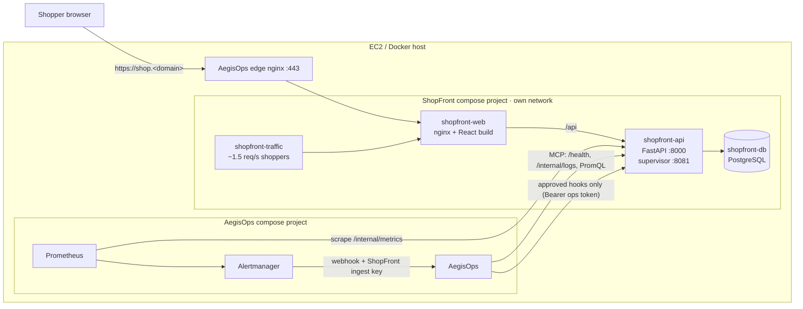

# ShopFront — demo e-commerce store monitored by AegisOps

A separate, independently deployable application: **React** storefront (catalog, product pages, cart, checkout, order history) served by nginx, a **FastAPI** API, and **PostgreSQL**. It is instrumented for Prometheus and has a demo-only, token-protected fault-injection module so AegisOps can be demonstrated against real failures.



`shopfront-api` and `shopfront-web` also join the shared `aegis-net` network; the database stays on ShopFront's private network only.

## Endpoints

| Path | Exposure | Purpose |
|---|---|---|
| `/` (web) | public via edge nginx | React storefront |
| `/api/products`, `/api/products/{id}`, `/api/categories`, `/api/cart/quote`, `/api/checkout`, `/api/orders` | public (proxied by web tier) | store API |
| `/health` | private network | 200 when the API and database are healthy, 503 otherwise |
| `/internal/metrics` | private network | Prometheus metrics |
| `/internal/logs` | private network | recent structured JSON logs |
| `/internal/faults/*` | private network, `X-Fault-Token`, off unless `FAULT_INJECTION_ENABLED=true` | demo fault injection |
| `/internal/ops/*`, `:8081/ops/restart` | private network, `Authorization: Bearer <ops token>` | allowlisted remediation hooks |

The web tier proxies only `/api/`, so the internal and fault endpoints are unreachable from the internet (requests for them return the storefront page).

**Metrics:** `shopfront_http_requests_total{method,route,status}`, `shopfront_http_request_duration_seconds` (histogram), `shopfront_db_up`, `shopfront_db_errors_total`, `shopfront_db_pool_in_use_ratio`, `shopfront_cpu_percent` and `shopfront_memory_percent` (of the container's limits, from cgroups), `shopfront_orders_total{result}`, `shopfront_deploy_timestamp_seconds`.

**Logs:** one JSON object per line on stdout and in `/internal/logs`: `timestamp`, `level`, `service`, `message`, plus `request_id`, `route`, `status`, `duration_ms` for requests.

## Run standalone

```bash
cd shopfront && cp .env.example .env
```

Edit `.env`, then:

```bash
docker compose up -d --build
```

Open http://localhost:8080. API tests (SQLite, no Docker):

```bash
cd shopfront/api && python -m pytest tests -q
```

## Attach to AegisOps (same host)

Start AegisOps first (it creates the `aegis-net` network), then:

```bash
cd shopfront && docker compose -f docker-compose.yml -f docker-compose.aegis.yml up -d --build
```

Register ShopFront with AegisOps and run the scenarios (from the AegisOps folder):

```bash
docker compose run --rm shopfront-check
```

On AWS this is done by `infra/aws/redeploy.sh`, which runs ShopFront as its own Compose project (`-p shopfront`) next to AegisOps.

## Fault injection (demo only)

Disabled unless `SHOPFRONT_FAULTS_ENABLED=true`; every call needs `SHOPFRONT_FAULT_TOKEN`; every fault expires automatically (default 600 s, max 900 s) and is bounded by the container limits (`cpus: 0.5`, `mem_limit: 384m`). Run from inside the API container:

```bash
docker compose -p shopfront exec shopfront-api python -m shopfront.faultctl inject http500
```

| Fault | `faultctl inject …` | Realistic cause | What breaks | AegisOps fix (hook) | Manual rollback |
|---|---|---|---|---|---|
| A | `http500` | buggy `checkout_v2` flag (release 2.4.0) | `POST /api/checkout` → 500 + traceback logs | `rollback_feature_flag` | `faultctl clear http500` |
| B | `latency --delay-ms 2500` | slow recommendations dependency | `GET /api/products/{id}` +2.5 s | `disable_recommendations` | `faultctl clear latency` |
| C | `db` | connection pool pointed at a dead port | `/health` 503, API 503, real `OperationalError` logs, `shopfront_db_up=0` | `reset_db_pool` | `faultctl clear db` |
| D | `cpu` | runaway report job on request workers | CPU ~100% of its 0.5-core limit, slower requests | `stop_background_jobs` | `faultctl clear cpu` |
| E | `memory` | leaking product-image cache | memory ~90% of 384 MiB | `release_memory` | `faultctl clear memory` |
| F | `downtime` | API process stopped by its supervisor | port 8000 closed, `up{job="shopfront"}=0` | `restart_service` (supervisor) | `faultctl clear downtime` |

`faultctl status` shows active faults. Restarting the container also clears every in-process fault.

**Safety:** fault injection is never exposed publicly, never targets AegisOps, generates no traffic floods (the synthetic shoppers run at a fixed ~1.5 req/s), and cannot outlive its timeout. Remediation hooks are an explicit allowlist: unknown actions return 404 and every call needs the ops token.

## Alert rules (in AegisOps' Prometheus)

| Alert | Condition |
|---|---|
| `ShopFrontHigh5xxRate` | 5xx ratio over 30 s > 5% for 30 s |
| `ShopFrontDown` | `up{job="shopfront"} == 0` for 30 s |
| `ShopFrontHighLatency` | p95 latency over 30 s > 1.5 s for 30 s |
| `ShopFrontDatabaseDown` | `shopfront_db_up == 0` for 15 s |
| `ShopFrontHighCPU` | `shopfront_cpu_percent > 85` for 30 s |
| `ShopFrontHighMemory` | `shopfront_memory_percent > 85` for 15 s |

Alertmanager routes `application="shopfront"` alerts to the AegisOps webhook with ShopFront's own ingest key.

## Demonstration sequence

1. Open the AegisOps console and the store side by side.
2. Inject a fault, e.g. `faultctl inject db`; reload the store and see it fail.
3. Within ~15–60 s the alert fires and an incident appears in the console under **shopfront** (source `prometheus_alertmanager`).
4. Open it: ADK steps, A2A specialist findings, MCP evidence (health, PromQL metrics, logs, live endpoint probes) and the root cause with its confidence.
5. Approve the top remediation (e.g. `reset_db_pool`); AegisOps calls only that hook.
6. After the settle time AegisOps re-checks health and metrics and marks the incident **resolved** with before/after values; the postmortem is generated. Reload the store: it works again.

Scripted version of all six: `docker compose run --rm shopfront-check` (writes `/app/data/shopfront_report.json`).
